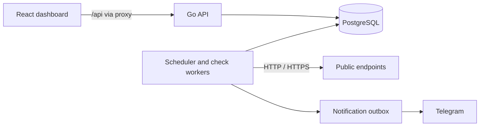

# Uptime Monitoring Platform

[](https://github.com/JasonTM17/Uptime-Monitoring-Platform/actions/workflows/ci.yml)
[](docs/toolchain.md)
[](docs/toolchain.md)
[](web/)

A personal full-stack project for monitoring public HTTP(S) endpoints, tracking incidents and delivering alerts. It combines a Go API and worker engine, PostgreSQL storage, and a React dashboard.

[Tiếng Việt](docs/readme-vi.md) · [Documentation](docs/README.md) · [API contract](docs/api/openapi.yaml) · [Release evidence](docs/releases/v0.1.0-evidence.md)

## What it does

- Create, pause, resume and inspect HTTP(S) monitors; explore sampled availability and latency.
- Track incidents and recovery; route alerts through verified Telegram notification channels.
- Manage accounts, roles, sessions, quotas and audit history through permission-scoped administration.
- Protect outbound checks from SSRF and persist incident and notification changes transactionally.

Availability is based on observed samples and coverage, rather than an assumption of continuous measurement. See [sampled statistics](docs/architecture/statistics.md) for the calculation and [product requirements](docs/product-requirements.md) for scope.

## Quick start

You need Docker with Compose, Go as specified by [go.mod](go.mod), and Node.js as specified by [.node-version](.node-version). Start from a fresh checkout:

1. Copy `.env.example` to `.env` and replace its placeholder database passwords. Keep the application DSNs and database settings consistent. Do not commit `.env`. For notification credentials and key management, follow the [notification runbook](docs/runbooks/notification-delivery.md).
2. For browser requests through Vite, create the ignored local file `compose.override.yaml` with the frontend origins. The default API allowlist covers its own port; without this override, browser requests from Vite can be rejected:

   ```yaml
   services:
     app:
       environment:
         TRUSTED_ORIGINS: "http://localhost:5173,http://127.0.0.1:5173"
   ```

   Adjust these exact origins if Vite chooses a different port.
3. Start PostgreSQL and the API, including the separate migration job:

   ```sh
   docker compose --profile tools --profile app up -d --build app
   docker compose ps
   ```

4. Install frontend dependencies and start the development server:

   ```sh
   npm --prefix web ci
   npm --prefix web run dev
   ```

Open the URL printed by Vite (normally `http://localhost:5173`). Its `/api` proxy forwards to the API on `localhost:8080` by default; see [vite.config.ts](web/vite.config.ts). The API exposes `/health/ready` for readiness. If ports or credentials differ, update the environment and proxy target accordingly. The database uses a persistent Docker volume; follow the [database runbook](docs/runbooks/local-database.md) for migrations, disposable tests and safe teardown.

Register a local account through the application. Administrative bootstrap and recovery are operator actions documented separately in the [admin runbook](docs/runbooks/admin-recovery.md).

## Architecture



The API and engine run within the application. The [engine lifecycle](docs/engine-lifecycle.md) explains ownership and incident transitions; the [SSRF boundary](docs/security/ssrf-boundary.md) describes outbound checks. The [OpenAPI document](docs/api/openapi.yaml) distinguishes implemented operations from future contracts.

## Start here

- [Product requirements and scope](docs/product-requirements.md): user-facing requirements and non-goals.
- [Business rules and implementation map](docs/business-rules.md): actors, incident transitions, notification boundaries and source links.
- [Documentation index](docs/README.md): toolchain, runbooks, testing and operations docs.
- [Toolchain pins](docs/toolchain.md) and the [local database runbook](docs/runbooks/local-database.md).
- [Container release policy](docs/releases/container-policy.md) and [release evidence](docs/releases/v0.1.0-evidence.md).

## Repository layout

| Path | Responsibility |
|---|---|
| `cmd/` | API application entry point |
| `internal/` | Backend domains, services, persistence, and adapters |
| `web/` | React and TypeScript dashboard |
| `migrations/` | PostgreSQL schema migrations |
| `docs/` | Product, API, architecture, testing, security, and operations documentation |
| `scripts/` | Local checks, acceptance tooling, and release automation |
| `tools/` | API contract and repository support tools |

## Development and operations

- [Testing guide](docs/testing.md): unit, integration, frontend and CI checks; integration tests require a disposable database.
- [Operational runbooks](docs/README.md#operations): local health, notification delivery, retention, backup and administrative recovery.
- [Contributing](CONTRIBUTING.md) and [security reporting](SECURITY.md).
- [Container policy](docs/releases/container-policy.md): publication, verification and operator prerequisites.

## Screenshots and demo

- Dashboard, monitor detail, and the new-monitor editor:
  [desktop](docs/media/screenshots/dashboard-desktop.png) ·
  [monitor detail](docs/media/screenshots/monitor-detail-desktop.png) ·
  [mobile editor](docs/media/screenshots/monitor-editor-mobile.png) ·
  [mobile dashboard](docs/media/screenshots/dashboard-mobile.png)
- Admin console — overview, user inventory, roles matrix, audit history:
  [overview](docs/media/screenshots/admin-overview-desktop.png) ·
  [users](docs/media/screenshots/admin-users-desktop.png) ·
  [roles](docs/media/screenshots/admin-roles-desktop.png) ·
  [audit](docs/media/screenshots/admin-audit-desktop.png) ·
  [mobile admin](docs/media/screenshots/admin-mobile.png) ·
  [empty/a11y state](docs/media/screenshots/states-and-accessibility.png)
- Recorded flows:
  [monitor incident → recovery](docs/media/monitor-incident-recovery.gif) ·
  [admin action → audit](docs/media/admin-role-and-audit.gif)

## Release and license

The project is licensed under [MIT](LICENSE). The `v0.1.0-rc.1` image is public on Docker Hub and GHCR, and the GHCR package is linked to this repository. See the [container release policy](docs/releases/container-policy.md) for distribution requirements and the [release evidence page](docs/releases/v0.1.0-evidence.md) for the verified digest and registry state. Hosted deployment guides cover [Render](docs/deployment/render.md), [Vercel](docs/deployment/vercel.md), and [Supabase](docs/deployment/supabase.md).
