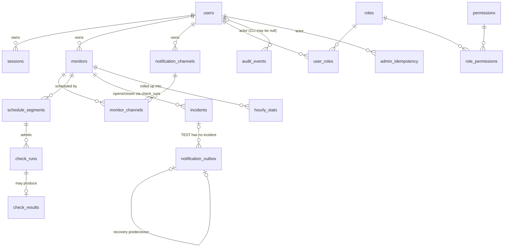

# Database design — `uptime` schema

Source of truth: `migrations/001…008` (forward + down pairs). This page
describes what the migrations actually create; it does not restate SQL.

Schema: PostgreSQL, single schema `uptime`. Ownership isolation and
fail-closed behavior are enforced at the schema level, not only in
application code.

## Entity-relationship overview

A reserved/interrupted run may have no accepted result. TEST notification
intents have no incident, and CLI audit events may have no user actor; the
optional relationships above preserve those failure/operator boundaries.

Singleton rows (one row, enforced by `CHECK(id=1)` / `id smallint
PRIMARY KEY`):

| Table | Role |
|---|---|
| `engine_control` | engine epoch + current owner instance; the **advisory lock**, not this row, is the write authority |
| `security_anchor` | monotonic version anchor for privileged mutations |
| `quota_budgets` | global monitor budget; seeded **empty** by migration — monitor creation must refuse while the row is absent (fail closed) |

## Table inventory

### Identity (001)

| Table | Purpose | Notable invariants |
|---|---|---|
| `users` | account identity | `email` lowercased/trimmed; `status='DISABLED' ⇔ disabled_at` pair check; per-user `monitor_limit` (0–10000); `security_version` for global revocation |
| `sessions` | opaque server-side sessions | 32-byte `token_hash`; `idle_expires_at ≤ expires_at`; partial index over live sessions only; revocation is a timestamp, not a delete |

### Owned monitors + channels (002)

| Table | Purpose | Notable invariants |
|---|---|---|
| `quota_budgets` | singleton global budget | absent row blocks all monitor creation |
| `monitors` | GET-only checks, 60–86400s interval | `timeout < interval`; streak bounds; `generation` + `last_reserved/applied_sequence` for stale-write fencing; soft delete via `deleted_at`; partial indexes exclude tombstones for paging/scheduling but a retained-cap index counts them |
| `notification_channels` | Telegram (kind pinned) | `enabled` only when `VERIFIED` and not deleted; verified ⇒ ciphertext + key version + receipt present; destination stored encrypted, mask for display |
| `monitor_channels` | monitor↔channel binding | composite FKs `(id,user_id)` bind **both** parents to the same owner — a user cannot attach another user's channel |

### Engine admission + observations (003)

| Table | Purpose | Notable invariants |
|---|---|---|
| `engine_control` | epoch/owner/heartbeat | singleton; epoch fencing for worker generations |
| `schedule_segments` | per-generation schedule window | at most one open-ended segment per monitor (partial unique index) |
| `check_runs` | durable slot reservation | `UNIQUE(monitor_id, segment_id, slot_at)`; one in-flight run per monitor; `status` includes `EXCLUDED/INTERRUPTED/STALE`; the admission-window index counts **every** status — a reservation is a charge |
| `check_results` | outcome per run | `eligible` ⇔ outcome in the six eligible outcomes; `SUCCESS ⇔ success IS TRUE`; rollup cursor via `rolled_up_at` |

### Incidents (004)

| Table | Purpose | Notable invariants |
|---|---|---|
| `incidents` | one open incident per monitor | partial unique index on open incidents; anchored to the `check_runs` that opened/resolved it (composite FKs); `close_reason` distinguishes `RECOVERED` from lifecycle closures (`CONFIG_CHANGED`, `DELETED`) — config change is not a recovery |

### Notification outbox (005, 008)

| Table | Purpose | Notable invariants |
|---|---|---|
| `notification_outbox` | durable delivery intent | `event_key` unique; one logical event per `(incident, kind, channel)`; recovery rows chain to their DOWN predecessor via self-FK; `LEASED ⇔ lease_token+expiry` pair check; non-TEST events must reference an incident; `safe_payload` carries non-secret projections only (no tokens, chat IDs, or raw target URLs); `rate_limit_refusals` counts provider rate-limit refusals independently of transient delivery attempts (`CHECK(rate_limit_refusals >= 0 AND rate_limit_refusals <= attempts)`) |

### Analytics (006)

| Table | Purpose | Notable invariants |
|---|---|---|
| `hourly_stats` | sampled hourly rollup | PK `(monitor_id, bucket_start)`; bucket must be hour-aligned in UTC; `valid_samples = successes + failures` |

### Admin / RBAC (007)

| Table | Purpose | Notable invariants |
|---|---|---|
| `permissions` | fixed catalog, seeded `ON CONFLICT DO NOTHING` | re-runs never overwrite an operator-adjusted catalog |
| `roles`, `role_permissions`, `user_roles` | bounded RBAC | five preset roles seeded with deterministic UUIDs; presets are never re-asserted over modified assignments |
| `security_anchor` | optimistic-concurrency anchor for admin flows | singleton, version monotonic |
| `audit_events` | append-only privileged audit | application role gets `SELECT, INSERT` only — `UPDATE/DELETE/TRUNCATE` revoked by migration when the role exists; `outcome ∈ SUCCESS/DENIED/FAILURE`; `safe_diff` is object-only JSON |
| `admin_idempotency` | replay protection for privileged writes | PK `(actor, action, target, key_hash)`; `request_hash` binds the body; rows expire |

## Cross-cutting patterns

- **Ownership binding at FK level:** owner-scoped tables carry
  `UNIQUE(id, user_id)` and child tables bind `(child_id, user_id)`
  composite FKs, so cross-owner references are unrepresentable in SQL —
  the IDOR defense does not depend on query discipline.
- **Soft delete + retained-cap accounting:** `deleted_at` tombstones are
  excluded from scheduling/paging indexes but counted by a separate
  retained index so quota enforcement sees them.
- **Fail-closed singletons:** empty `quota_budgets` and unowned
  `engine_control` make missing configuration refuse work instead of
  assuming defaults.
- **Sequence fencing:** `monitors.last_reserved_sequence ≥
  last_applied_sequence` pairs with per-monitor run sequence to keep
  edit-vs-observe races honest.
- **Rollup + retention:** `check_results.rolled_up_at` and
  `hourly_stats.finalized_through` partition raw from rolled-up data;
  operator semantics live in [runbooks/retention.md](../runbooks/retention.md)
  and [architecture/statistics.md](statistics.md).
