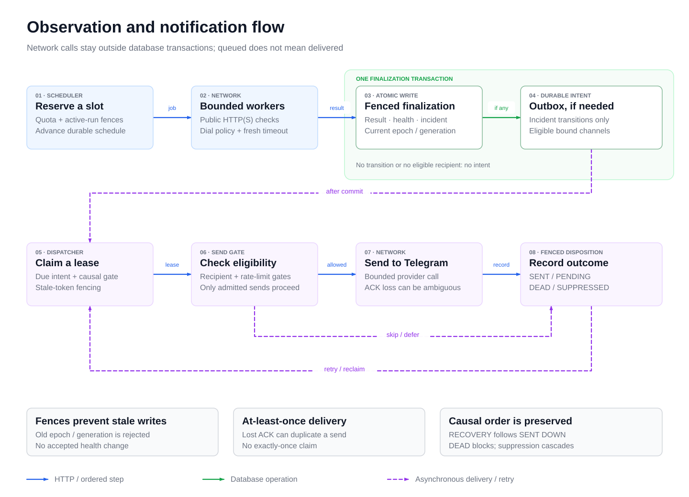

# System design, trade-offs and failure cases

This guide connects the product's architecture questions to the contracts that
answer them. It complements the [business rules](../business-rules.md),
[database design](database.md) and [engine lifecycle](../engine-lifecycle.md).
The failure cases below are expected outcomes and test entry points, not a
claim that every production environment has been exercised.

## System overview

[Full-size PNG](diagrams/system-overview.png) · [Editable SVG](diagrams/system-overview.svg)

The dashed application boundary groups components of one process. Green arrows
are database operations; the outbox is durable PostgreSQL state, not a separate
message broker. The browser and operator CLI have distinct authority. Telegram
delivery is conditional on configuration; external services are logical
dependencies, not proof of a deployed environment.

## Observation and delivery flow

[Full-size PNG](diagrams/observation-delivery-flow.png) · [Editable SVG](diagrams/observation-delivery-flow.svg)

The diagram follows the alert-producing path from left to right. Ordinary
unchanged-health observations stop after result/state finalization. A real
incident-open/recovered effect appends intents only for eligible bound channels;
no transition or no eligible recipients means no intent to dispatch. Recipient
rejection or rate-limit deferral can bypass the provider call. Only eligible retries/expired leases
return to the delivery loop; terminal rows do not automatically restart. ACK
loss can cause a duplicate provider send. A RECOVERY remains behind its DOWN
predecessor, with the [delivery runbook](../runbooks/notification-delivery.md)
owning exact retry and suppression rules.

These diagrams are self-contained source illustrations with PNG exports, not
runtime screenshots. Update the editable SVG alongside its PNG when boundaries
change. Component wiring is owned by [cmd/api](../../cmd/api/main.go),
[finalization](../../internal/engine/finalize.go) and the
[dispatcher](../../internal/notification/dispatcher.go).

## Architecture questions and answers

| Question | Decision and trade-off | Owning contract |
| --- | --- | --- |
| Why one Go application with PostgreSQL? | A modular monolith keeps resource, incident and outbox changes inside a shared transaction and a small operating surface. It accepts one deployment/failure domain; distributed scheduling is future scope. | [Composition](../../cmd/api/main.go), [requirements](../product-requirements.md) |
| Why one scheduler owner rather than all replicas scheduling? | A database ownership epoch and durable reservations avoid duplicate active work. Losing ownership stops writes; another process can reconcile durable work. This favors bounded recovery over transparent multi-region scheduling. | [Ownership and recovery](../engine-lifecycle.md) |
| Why an outbox instead of sending inside finalization? | Provider latency/failure must not hold the transaction recording the target observation. Durable intents survive restarts, with asynchronous delivery and possible duplicates after ACK loss. | [Delivery guarantees](../runbooks/notification-delivery.md) |
| Why UNKNOWN and freshness separate from UP/DOWN? | Absence of accepted evidence cannot identify target health. A missing sample, paused schedule or collector failure must not create a target incident. | [Incident decisions](../business-rules.md#observations-and-incident-decisions) |
| Why generation/version and security epochs? | Resource edits and authority changes are different concurrency boundaries. An old request/result must not overwrite current configuration or commit using revoked authority. Conflicts require an explicit re-read. | [Session fence](../../internal/auth/middleware.go), [engine fences](../engine-lifecycle.md) |
| Why verify notification destinations outside the browser? | Creating a label is not proof of recipient control. Operator verification and encrypted storage keep raw destinations/keys out of normal browser writes and responses. | [Recipient lifecycle](../runbooks/notification-delivery.md#channel-lifecycle-cmdchannel) |
| Why no redirects and no environment proxy for checks? | A target must not turn a public check into a request to another trust boundary. Safety is enforced at actual dial as well as at input, rather than trusting an earlier DNS answer. | [SSRF boundary](../security/ssrf-boundary.md), [redirect tests](../../internal/checker/redirect_test.go) |
| Why sampled availability rather than an SLA percentage? | The system knows its schedule and accepted samples, not continuous target state. Coverage and represented-window bounds expose missing evidence; aggregate counts cannot reconstruct latency quantiles. | [Statistics](statistics.md) |
| Why soft deletion and retained allocation? | History and causal references must survive user-visible removal, while repeated create/delete must not bypass allocation limits. Deletion is not a storage-reclamation guarantee. | [Quota rules](../business-rules.md#monitor-lifecycle-and-quota), [retention](../runbooks/retention.md) |
| Why recent-auth, idempotency and audit for admin actions? | Elevated intent, duplicate submission and current permission are separate checks. A replay must not revive revoked authority, and a successful privileged mutation needs its audit record in the same transaction. | [Admin security races](../testing/admin-security.md), [RBAC](../security/rbac-matrix.md) |

## Trust boundaries

| Boundary | What is distrusted | Control and remaining limit |
| --- | --- | --- |
| Browser → API | Owner/role fields, stale versions, forged cross-origin writes | Server identity, permissions, strict input and CSRF. UI hiding is not authorization; see [API](../api/openapi.yaml). |
| API → database | Stale principal and competing state changes | Locked transactional predicates and constraints; see [schema](database.md). A privileged DBA is still trusted. |
| Checker → target network | URL aliases, DNS rebinding, blocked destinations and redirects | Actual-dial policy, bounded work and no redirect following; see [SSRF](../security/ssrf-boundary.md). Public target reachability is not guaranteed. |
| Outbox → provider | Timeouts, rate limits, lost ACK and destination changes | Bounded retry, lease fencing and recipient revalidation; see [delivery](../runbooks/notification-delivery.md). Exactly-once delivery is not promised. |
| Operator → running system | Wrong database, secret disclosure, irreversible maintenance | Separate operator runbooks and disposable test resources. CLI access is an authority boundary, not an ordinary owner capability. |

## Twenty failure scenarios

Each row names the business outcome that must survive the failure. Linked tests
make the oracle reviewable; use [testing](../testing.md) for execution and
evidence levels. A synthetic or database test does not establish a live provider.

| Case | Failure / competing action | Required outcome and recovery | Oracle owner |
| --- | --- | --- | --- |
| F01 | Invalid registration or injected role fields | Reject invalid input without granting authority; correct input before retrying. | [Registration validation](../../internal/auth/registration_test.go) |
| F02 | Concurrent registration of the same canonical email | Exactly one account; the losing request cannot create a second identity. | [Concurrent registration](../../internal/auth/registration_integration_test.go) |
| F03 | Wrong password, nonexistent or disabled account | No issued session; no account-state disclosure through distinct credential errors. | [Login cases](../../internal/auth/login_test.go) |
| F04 | Session revoked, epoch changed or account suspended after initial TEST authentication | Reject before mutation; no TEST intent remains. An aborted actor transaction rolls its intent back. | [Test-send denial/rollback](../../internal/notification/test_handler_integration_test.go) |
| F05 | Permission removed while a privileged request/replay competes | Stale authority cannot authorize the mutation; reauthenticate/reload permissions. | [Security races](../../internal/admin/security_races_integration_test.go) |
| F06 | Two admins concurrently remove the last active SUPER_ADMIN grants | At least one active SUPER_ADMIN remains; ordinary API use cannot bypass the guard. | [Last-admin races](../../internal/admin/superadmin_integration_test.go) |
| F07 | Concurrent monitor creation or quota reduction | Do not oversubscribe admission or lower quota below live usage; report conflict. | [Monitor quotas](../../internal/monitor/repository_integration_test.go), [admin quota races](../../internal/admin/sessions_quotas_integration_test.go) |
| F08 | Repeated pending-channel create/delete | Tombstoned pending allocations still count; operator verification is the recovery path. | [Channel allocation](../../internal/notification/channels_integration_test.go) |
| F09 | Target resolves/rebinds to a forbidden address or attempts a redirect | Deny outbound access without contacting the forbidden target; no false target-health evidence from policy rejection. | [DNS rebinding](../../internal/checker/rebinding_test.go), [redirects](../../internal/checker/redirect_test.go) |
| F10 | Queue full or a reserved job waits too long | Keep work bounded and missing coverage honest; do not create an incident from queue delay. | [Queue/recovery cases](../../internal/engine/recovery_integration_test.go) |
| F11 | Engine loses database ownership | Old owner stops protected writes; no stale-epoch finalization. | [Ownership-loss capacity cases](../../internal/engine/capacity_integration_test.go) |
| F12 | Crash after durable reservation | A new owner reconciles interrupted work without fabricating a target result or a catch-up storm. | [Reservation recovery](../../internal/engine/capacity_integration_test.go), [recovery](../../internal/engine/recovery_integration_test.go) |
| F13 | Edit, pause, delete or suspension races with finalization | Generation/account fences decide the winner; rejected evidence does not overwrite current state. | [Mutation schedules](../../internal/engine/mutation_schedule_test.go), [suspension](../../internal/engine/suspension_fence_integration_test.go) |
| F14 | DOWN monitor is edited while its incident closes for configuration | Reset stale DOWN to UNKNOWN without inventing recovery; a new sequence of failed evidence can open another incident. Preserve non-DOWN streaks. | [Monitor edit regression](../../internal/monitor/mutations_integration_test.go) |
| F15 | Excluded observation interrupts a failure/recovery streak | Reset streaks without changing health or opening/recovering an incident. | [Reducer cases](../../internal/incident/reducer_test.go) |
| F16 | Duplicate/stale finalization or a partial database failure | Accepted result/state/incident/outbox is atomic and idempotent; rejected/rolled-back work leaves no partial transition. | [Finalize atomicity](../../internal/engine/finalize_integration_test.go), [outbox identity](../../internal/notification/outbox_integration_test.go) |
| F17 | Repeated rate-limit refusal before the first transient provider failure | Refusals do not consume the send budget; a separate refusal ceiling and effective-attempt budget still bound retries. | [Retry regression](../../internal/notification/retry_budget_audit_test.go), [lease accounting](../../internal/notification/lease_integration_test.go) |
| F18 | Provider accepts but the ACK is lost, or a lease expires | Preserve bounded at-least-once semantics and stale-token fencing; a possible duplicate is reported as ambiguity. | [Crash/ACK-loss cases](../../internal/notification/ambiguity_integration_test.go), [lease fencing](../../internal/notification/lease_integration_test.go) |
| F19 | DEAD DOWN precedes RECOVERY or an operator suppresses the stream | Block RECOVERY behind DEAD; retry only the head or cascade suppression, without pretending a send occurred. | [Causal controls](../../internal/notification/operations_integration_test.go) |
| F20 | Rollup/retention is interrupted or raw data ages across a partial hour | Do not purge unrolled/protected evidence or double-count raw/hourly samples; expose a partial represented window. | [Retention](../../internal/analytics/retention_integration_test.go), [denominators](../../internal/analytics/denominators_integration_test.go), [window contract](../../internal/analytics/api_integration_test.go) |

## Learning and review route

Follow [the user journey](../user-guide.md), then the
[business decision tables](../business-rules.md). Read the
[API](../api/openapi.yaml) and [database](database.md) before the
[engine](../engine-lifecycle.md), [delivery](../runbooks/notification-delivery.md)
and [statistics](statistics.md) contracts. Use each linked test to explain a
success, a denial and a recovery case; select the matching disposable check
from [testing](../testing.md).

Capacity at 100, 1,000 or 10,000 monitors requires measured evidence or an
explicitly labeled projection; the [capacity protocol](../testing/capacity.md)
separates them. This guide supplies review answers and failure scenarios, not
new benchmark, hosted, real-provider or release-image evidence.
