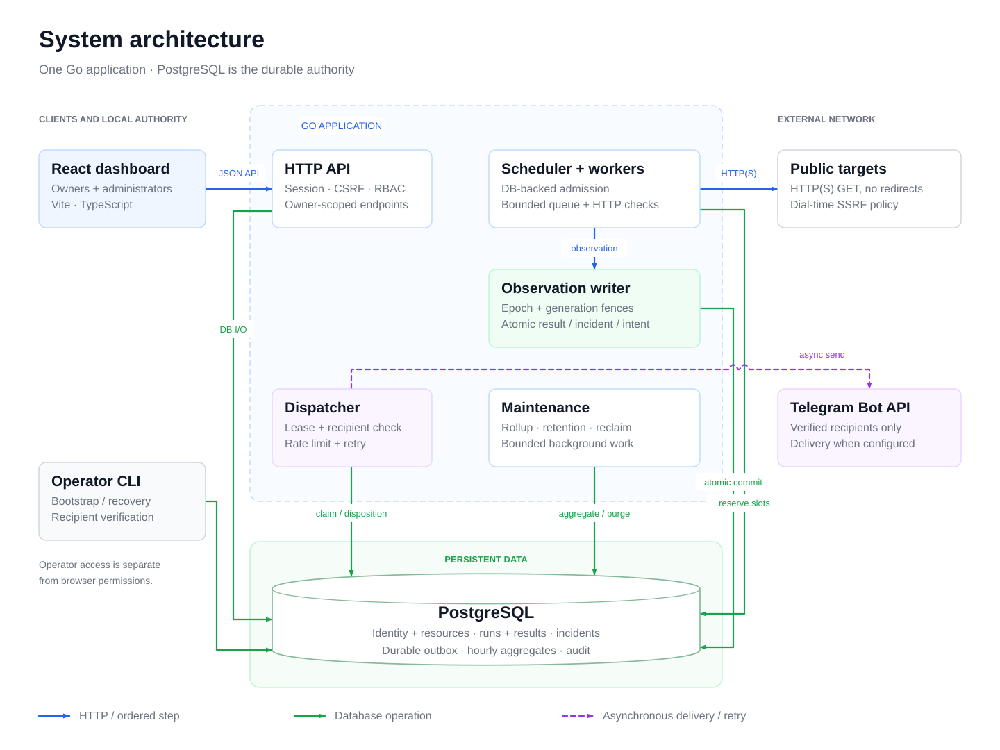

# Uptime Monitoring Platform — Tóm tắt tiếng Việt

Dự án cá nhân học sâu backend Go: giám sát uptime HTTP(S) công khai,
cảnh báo sự cố, quản trị nâng cao và dashboard React.

Image `v0.1.0-rc.1` đã được phát hành công khai trên Docker Hub và GHCR.
Kết quả kiểm tra, digest và giới hạn được ghi trong
[`releases/v0.1.0-evidence.md`](releases/v0.1.0-evidence.md). Triển khai
hosted chưa được xác minh.

## Sản phẩm đã có

- Người dùng quản lý monitor HTTP(S), xem uptime/latency theo mẫu lấy,
  theo dõi sự cố và nhận thông báo Telegram đã xác minh.
- Quản trị viên có phân quyền tường minh: tài khoản, phiên, quota, sức
  khỏe vận hành, vai trò và lịch sử audit append-only.
- Backend Go + PostgreSQL: scheduler giới hạn, worker bounded, checker
  chống SSRF theo kết nối, incident/outbox transactional.
- Frontend React + TypeScript: responsive, có trạng thái và hỗ trợ a11y.

## Bằng chứng và media

Ảnh chụp và GIF trong [`media/`](media/) được capture từ ứng dụng thật
chạy trên harness cục bộ deterministic (tài khoản demo tổng hợp, target
fixture cô lập) — không phải mockup. Manifest có hash và provenance cho
từng artifact.

Xem [chính sách phát hành](releases/container-policy.md) cho điều kiện
publish và [tài liệu triển khai](deployment/) cho các hướng dẫn hosted.

## Chạy cục bộ

Xem [hướng dẫn bắt đầu nhanh](../README.md#quick-start),
[database local](runbooks/local-database.md) và [vận hành](runbooks/local-operations.md).

## Sử dụng và hiểu nghiệp vụ

- [Hướng dẫn sử dụng](user-guide.md): luồng từ tài khoản mới đến xử lý cảnh báo, quota và phiên.
- [Quy tắc nghiệp vụ](business-rules.md): trạng thái, điều kiện cho phép/từ chối và nguồn kiểm chứng.
- [Yêu cầu và phạm vi thực tế](product-requirements.md): phần đã có, thao tác operator và phần chưa được xác minh.

## Kiến trúc

Xem [sơ đồ luồng kiểm tra và thông báo](architecture/system-design.md#observation-and-delivery-flow),
[quyết định kiến trúc](architecture/system-design.md) và
[ERD database](architecture/database.md). Đây là mô hình các thành phần trong
code; không phải bằng chứng deployment hosted.
